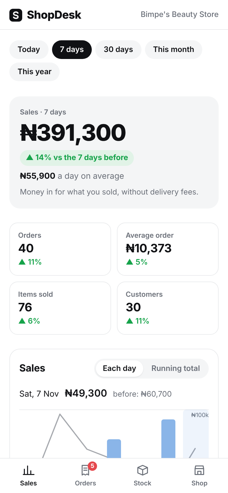
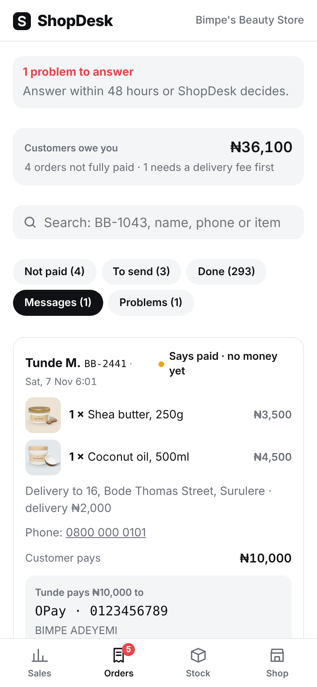
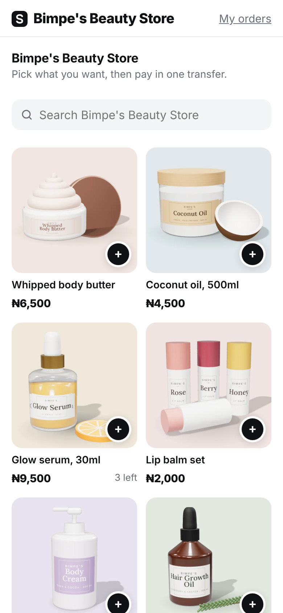
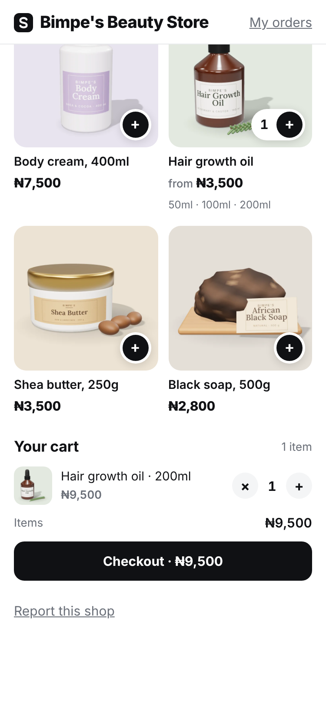
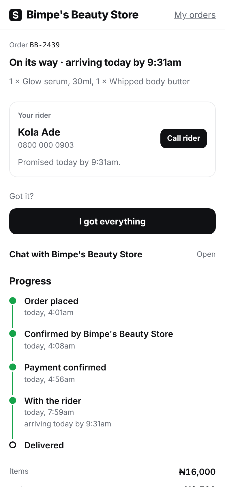

# ShopDesk

ShopDesk is an order desk for small shops that sell through chat and social media. A vendor adds products, shares one link, and customers order from it and pay by bank transfer straight into the vendor's own account. Both sides follow the order from payment to delivery, and an admin oversees every shop without seeing customer details by default.

Live at [shopdesk.com.ng](https://shopdesk.com.ng).

| Sales | Orders | Shop page | Cart | Order tracking |
|---|---|---|---|---|
|  |  |  |  |  |

## Features

**Customers**
- Browse a shop's page, choose sizes or other options, and keep a cart per shop that survives a refresh
- Separate cart and checkout pages with saved details, and delivery or pick-up
- Customer tab bar: Shops (every shop they have opened or ordered from), Orders, Cart and Account
- Passwordless sign-in with an emailed 6-digit code
- Order page with live status, rider name and number, and the promised delivery time
- Chat with the shop inside the order, report a problem with photos, and confirm receipt

**Vendors**
- Products with photos, one price or a list of options (size, colour, pack), sale prices and per-option stock
- Orders board: set the delivery fee, confirm payment, packing checklist, hand to a rider, mark delivered
- Sales figures and charts, low-stock warnings, Excel export
- Push notifications, with an email digest as a fallback when the app has not been opened

**Admin**
- Vetting of new shops, suspension and closure, nudges for quiet shops, announcements
- The ShopDesk chat: talk to any shop inside the app, signed only as ShopDesk (approvals, checks and replies all happen there)
- Dispute handling with refunds, reports, a "needs attention" list and a full audit log
- Customer details are only visible through a support view that requires a written reason and is logged

## Tech stack

- **Frontend:** React 18, Vite. No UI framework; plain CSS in `src/styles.css`
- **Backend:** Supabase (PostgreSQL, Auth, Storage, Realtime)
- **Server logic:** PostgreSQL functions and row-level security in `supabase/schema.sql`
- **Notifications:** a Supabase Edge Function (`supabase/functions/push`) for Web Push and SMTP email, scheduled with `pg_cron` and `pg_net`
- **Pay online and delivery:** a Supabase Edge Function (`supabase/functions/money`) for Paystack split payments and Shipbubble courier bookings, both off until switched on in Admin
- **Hosting:** any static host. The live site runs on cPanel (Apache); a `vercel.json` rewrite is included as well

## Getting started

Requirements: Node.js 18 or later and a Supabase project.

```bash
git clone https://github.com/Adeleyeha-17/shopdesk.git
cd shopdesk
npm install
cp .env.example .env    # then fill in the values below
npm run dev             # http://localhost:5173
```

| Variable | Description |
|---|---|
| `VITE_SUPABASE_URL` | Supabase project URL |
| `VITE_SUPABASE_ANON_KEY` | Supabase publishable (anon) key. Never the secret key |
| `VITE_PRIVACY_EMAIL` | Contact address shown on the privacy page |

The database has to be created before the app can sign anyone in. See [docs/setup.md](docs/setup.md).

On Windows, `start-shopdesk.bat` installs dependencies on first run and starts the dev server.

### Scripts

| Command | Description |
|---|---|
| `npm run dev` | Start the dev server (also reachable from other devices on the same network) |
| `npm run build` | Build the production site into `dist/` |
| `npm run preview` | Serve the production build locally |

## Project structure

```
src/
  App.jsx          routes: which page is shown for which path
  customer/        shop page and cart, checkout, order page, order history
  vendor/          vendor app: Sales, Orders, Stock and Shop tabs
  admin/           admin console (/admin)
  shared/          sign-in, page frame, chat, error handling, privacy page
  lib/             Supabase client, error messages, money, dates, photos, products, location
  styles.css
public/            service worker (push notifications), icons, manifest, .htaccess
supabase/
  schema.sql       tables, row-level security and every server-side function
  updates/         incremental updates for databases created from an older schema
  owner-lock.sql   pins the single admin account
  functions/push/  Edge Function: push notifications and email digests
  functions/money/ Edge Function: Paystack payments and Shipbubble deliveries
  email/           sign-in email templates
docs/              setup, deployment, architecture and business rules
```

## Documentation

- [Setup](docs/setup.md): database, admin account, notifications and email
- [Deployment](docs/deployment.md): building and publishing, applying database updates
- [Architecture](docs/architecture.md): how the pieces fit together and the security model
- [Business rules](docs/rules.md): what the database enforces

## Security

All authorisation is enforced in the database. Tables are protected by row-level security, and changes go through `SECURITY DEFINER` functions that validate their input and are granted per role. Only the publishable key is used in the browser. Please report security issues privately to info@shopdesk.com.ng rather than opening a public issue.

## License

Copyright © 2026 ShopDesk. All rights reserved.
